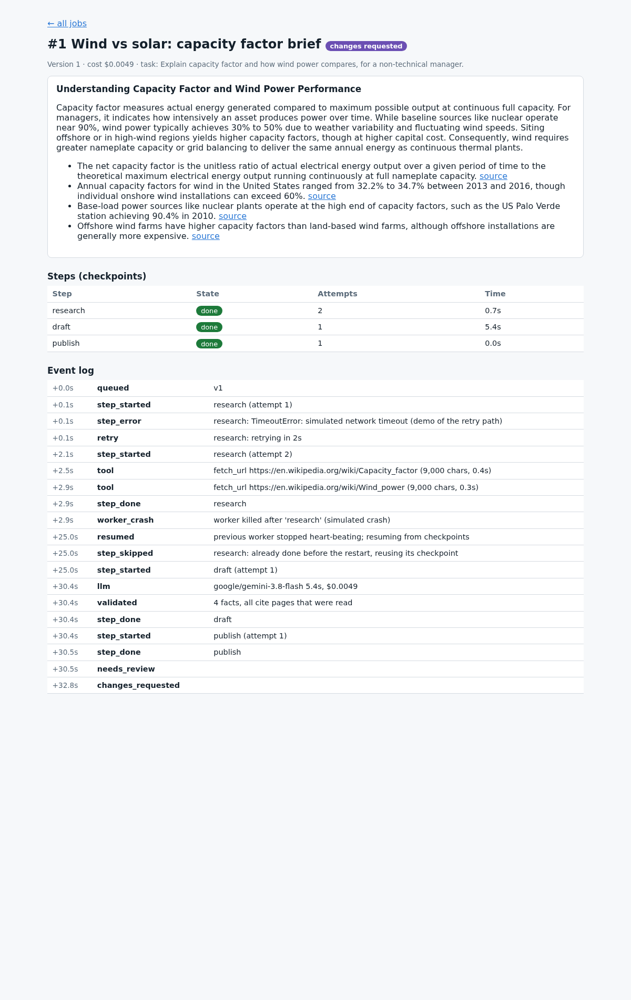
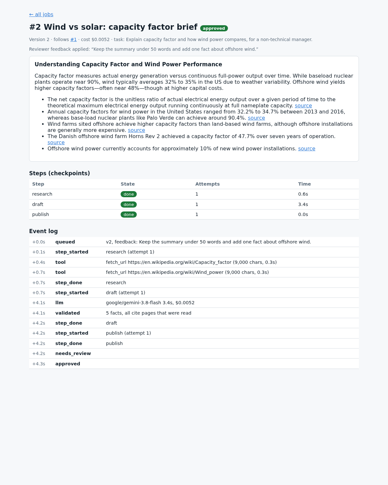
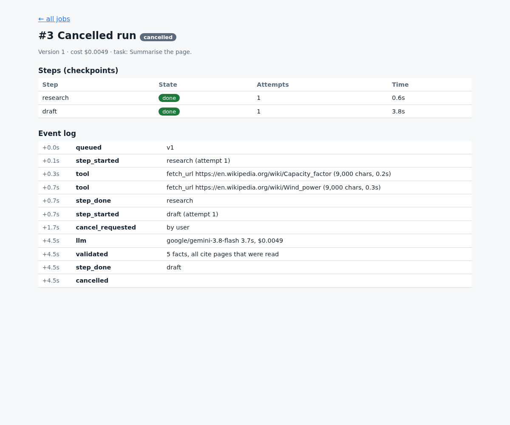
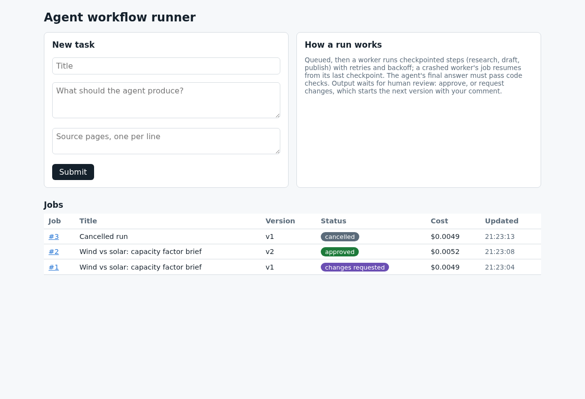

# Agent workflow runner (demo)

A forced network error retried after 2 s with backoff, a worker killed mid-job resumed from its checkpoint, every final answer must pass code checks before a human review; cancellation and cost per run. Every screenshot below is from a real run.

**Demo page:** https://slimanechanchoul.com/agent-workflow-demo/

## What it demonstrates

A small dashboard (FastAPI) and a background worker that run AI tasks the way a production system should:

- **Checkpointed steps.** Each job runs as `research` -> `draft` -> `publish`. A finished step is saved, so a restart never repeats it.
- **Retries with backoff.** A failed step is tried up to 3 times, waiting 2 s before the second attempt and 4 s before the third.
- **Crash recovery.** The worker sends a heartbeat every 3 s. If it stops for 20 s, the next worker takes the job and resumes from the last finished step.
- **Code-checked answers.** The agent calls tools (`fetch_url`, `submit_brief`). Its brief is rejected unless the summary is at most 90 words, it has 3 to 5 facts, and every fact cites a page the agent actually read.
- **Human review.** Output waits in `needs_review`. The reviewer approves, or requests changes, which starts version 2 with the comment and the previous output.
- **Cancellation and cost.** A user can cancel a queued or running job; the model cost of every call is added to the job.
- **Model fallback.** If the first model fails, the next one in the list is tried (Gemini models through OpenRouter).

The demo task: write a short brief for a non-technical manager from two public Wikipedia pages (capacity factor, wind power).

## The real run, step by step

All four screenshots come from one run of `scenario.py`, with failures forced on purpose.

### 1. Network error, retry, crash, resume



- The first page fetch fails with a simulated timeout. The step is retried after 2 s and succeeds on attempt 2.
- Right after `research` is saved, the worker is killed (simulated crash).
- A new worker sees the stale heartbeat at +25.0 s, skips `research` (its checkpoint is reused, no page is read again) and runs `draft`.
- The brief passes the code checks (4 facts, all citing pages that were read) and goes to review. Model cost: $0.0049.

### 2. Changes requested, then approved



The reviewer asked: "Keep the summary under 50 words and add one fact about offshore wind." Version 2 ran with that comment and the version 1 brief as context. It came back with a shorter summary and more offshore-wind facts (Horns Rev 2, share of new installations), passed the code checks, and was approved. Model cost: $0.0052.

### 3. Cancelled by the user



A third job was cancelled while the `draft` step was running. The model call already in flight finished, then the worker stopped before `publish`: nothing was published, and the cost of that call ($0.0049) stays on the job.

### 4. Dashboard



All jobs with version, status and cost. A new task is a title, an instruction and the source pages.

## How to run

Python 3.12. You need an OpenRouter API key (read from the environment only).

```bash
python3 -m venv .venv && . .venv/bin/activate
pip install -r requirements.txt
export OPENROUTER_API_KEY=your-key
```

Dashboard and worker, in two terminals, from this folder:

```bash
uvicorn app:app --port 8791      # open http://127.0.0.1:8791
python worker.py                 # add --once to stop when the queue is empty
```

Submit a task with source pages from `en.wikipedia.org` (the only host the `fetch_url` tool allows; edit `ALLOWED_HOSTS` in `agent.py` to add more).

Force the failures by hand:

```bash
FAIL_FIRST_FETCH=1 CRASH_AFTER=research python worker.py --once   # timeout, retry, then crash
python worker.py --once                                            # wait 20 s first: resumes from the checkpoint
```

Replay the whole story and the screenshots (about one minute):

```bash
python scenario.py
```

It deletes `data/`, starts the dashboard on port 8791, runs the four steps above and saves the screenshots to `outputs/` (needs `google-chrome` on the PATH). The recorded run called the model three times (once per job) and cost $0.015 in total.

## Files

| File | What it does |
|---|---|
| `app.py` | Dashboard: submit, watch live, review, cancel |
| `worker.py` | Claims jobs, runs checkpointed steps, retries, heartbeat |
| `agent.py` | Tool-calling agent, tools, code checks, model fallback |
| `db.py` | SQLite job store: jobs, steps (checkpoints), events |
| `scenario.py` | Replays the run with forced failures and takes the screenshots |

The job store is SQLite here; the schema is plain SQL. `data/` (the database and the saved briefs) is created at run time and is not in the repo.

## Limits

- One step can run twice if a worker dies in the middle of it (at-least-once). Steps that write elsewhere should be idempotent.
- Cancellation is checked between steps and between agent turns, so a model call already started finishes first.
- This is a demo: no login on the dashboard, and the code checks are specific to the brief task.

## Need this for your business?

Your own tasks and tools, a queue on PostgreSQL or Redis, Slack or email review, and cost limits per job. I build these tools. https://www.upwork.com/freelancers/~01d6ae0f1a06a43ac0

## License

MIT
